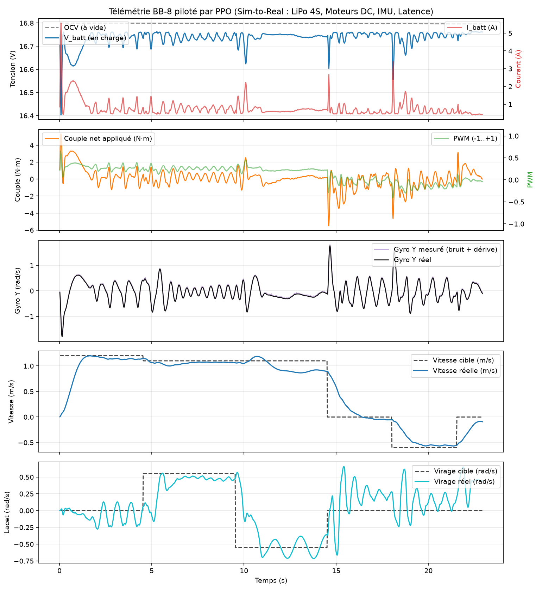
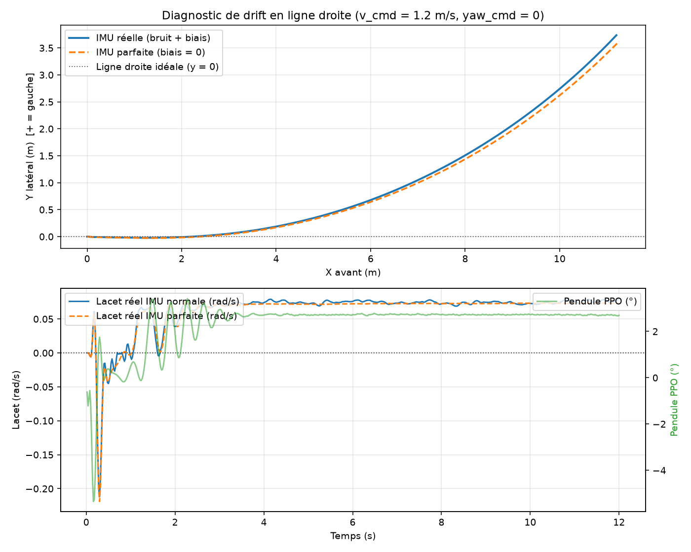
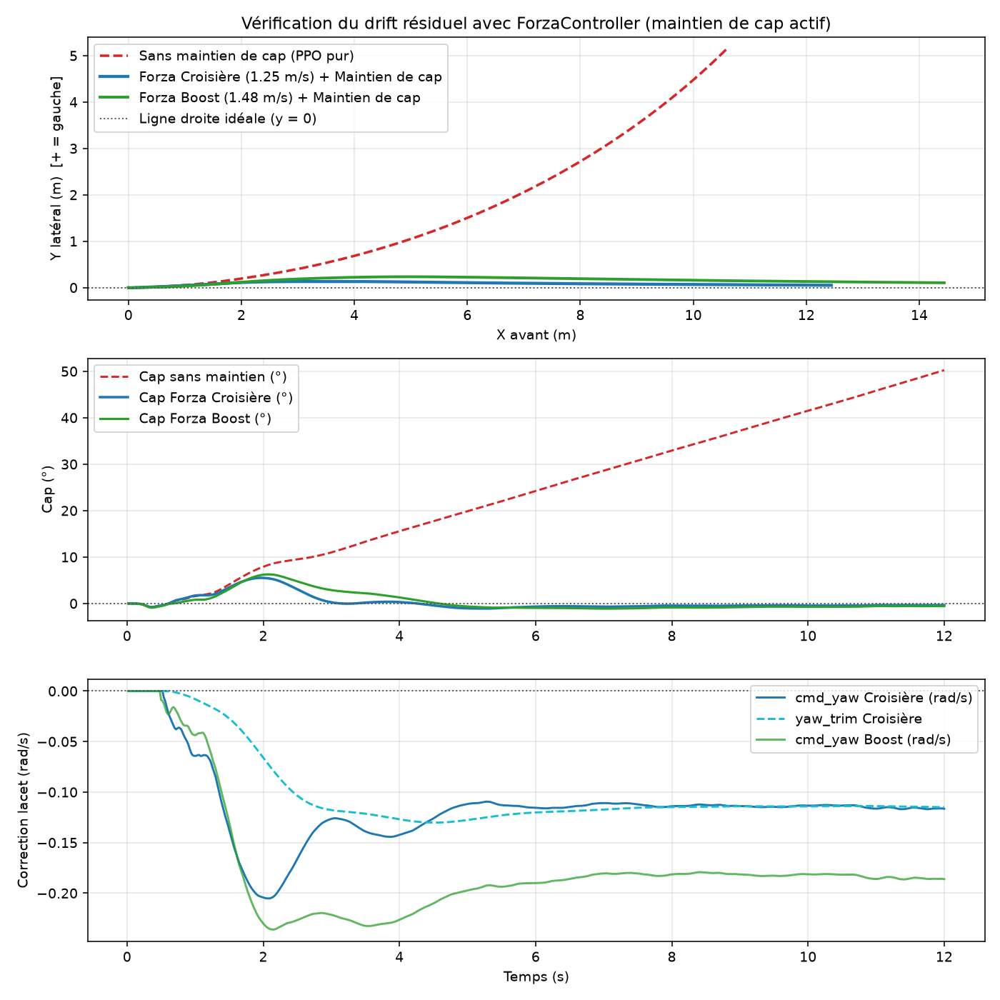
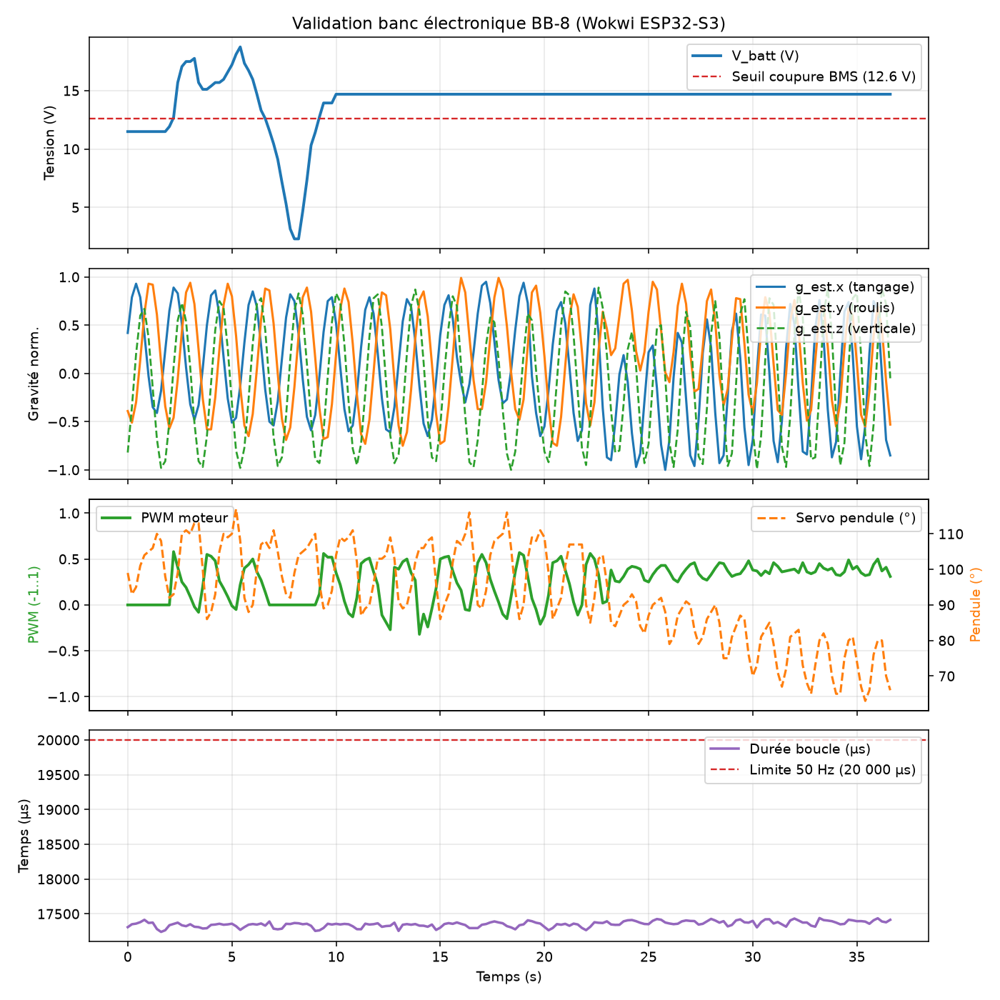

# Robot Sphérique Pendulaire — Contrôle RL (PPO) & Portage Embarqué ESP32-S3

Conception, modélisation physique et déploiement embarqué d'un robot sphérique à entraînement par pendule interne (architecture de type BB-8). Le contrôleur est entraîné par apprentissage par renforcement (**PPO**) sous **MuJoCo** à partir de capteurs bruités réalistes, puis exporté en **C++ autonome** pour exécution temps réel à **50 Hz** sur **ESP32-S3**.

---

## Architecture technique

- **Modélisation mécanique & physique** : assemblage multi-corps MuJoCo (`bb8_cad.xml`) généré de manière paramétrique avec export CAO (`STEP` / `STL`).
- **Simulation matérielle fidèle** : modèle électrique LiPo 4S (chute de tension sous charge, coupure BMS à `12,6 V`), dérive et bruit d'IMU, quantification encodeur en quadrature et dynamique des actionneurs.
- **Politique de contrôle PPO (`16 -> 128 -> 128 -> 2`, `tanh`)** : espace d'observation strictement limité aux 16 grandeurs accessibles sur le matériel réel (vecteur gravité estimé par filtre complémentaire, vitesses angulaires gyroscopiques, vitesse encodeur, vitesse coque reconstruite, position pendule, tension batterie normalisée, commandes filtrées, consignes et intégrateurs d'erreur à fuite).
- **Téléopération & maintien de cap** : couche de commande haut niveau (`teleop_bb8.py`) intégrant rampes d'accélération et asservissement PI de cap en ligne droite.
- **Inférence embarquée C++ sans dépendance** : export automatique des poids PyTorch et statistiques `VecNormalize` vers `wokwi_bb8/include/bb8_policy.h` (`74,1 Ko` en mémoire Flash, erreur numérique `< 10⁻⁷` face à PyTorch).
- **Validation temps réel (HIL simulé)** : boucle complète capteurs, filtre complémentaire, inférence PPO et sécurité BMS validée à **50 Hz** sur ESP32-S3 (Wokwi / PlatformIO).

---

## Organisation du dépôt

```text
bb8-sim/
├── bb8.xml                     # Modèle MuJoCo de référence
├── bb8_cad.xml                 # Modèle MuJoCo couplé aux maillages CAO
├── bb8_arena.xml               # Environnement de test en espace ouvert
├── build_bb8_cad.py            # Génération paramétrique CAO (STEP / STL)
├── cad_export/                 # Maillages mécaniques pour fabrication additive
├── bb8_electronics.py          # Modèles capteurs (IMU, encodeur) et batterie LiPo 4S
├── bb8_env.py                  # Environnement Gymnasium (16 observations, PPO)
├── train_bb8.py                # Pipeline d'entraînement PPO + VecNormalize
├── eval_bb8.py                 # Évaluation quantitative et génération de télémétrie
├── teleop_bb8.py               # Téléopération interactive avec maintien de cap
├── measure_drift.py            # Caractérisation de la dérive en boucle ouverte
├── eval_heading_hold.py        # Validation du correcteur de maintien de cap
├── run_bb8.py                  # Loi de commande classique de référence (PI)
├── run_bb8_electronics.py      # Simulation boucle fermée avec modèle électronique
├── export_ppo_cpp.py           # Compilateur de politique PyTorch/SB3 -> header C++
├── analyze_wokwi.py            # Post-traitement des logs série et métriques temps réel
├── models/best_model/          # Politique PPO retenue et statistiques de normalisation
└── wokwi_bb8/                  # Firmware ESP32-S3 (PlatformIO + banc virtuel Wokwi)
    ├── platformio.ini          # Configuration de build (-O3 -ffast-math)
    ├── diagram.json            # Schéma de câblage du banc de test
    ├── wokwi.toml              # Configuration du simulateur
    ├── include/bb8_policy.h    # Réseau de neurones généré en C++ statique
    └── src/main.cpp            # Boucle de contrôle temps réel 50 Hz
```

---

## Installation et exécution

### 1. Environnement de simulation (Python / MuJoCo)

```bash
git clone [https://github.com/](https://github.com/)<votre-utilisateur>/bb8-sim.git
cd bb8-sim

python3 -m venv .venv
source .venv/bin/activate
pip install -r requirements.txt
```

| Tâche | Commande |
| :--- | :--- |
| **Téléopération interactive (MuJoCo)** | `mjpython teleop_bb8.py` *(ou `python` sous Linux/Windows)* |
| **Évaluation de la politique PPO** | `python eval_bb8.py` |
| **Mesure de dérive & maintien de cap** | `python measure_drift.py && python eval_heading_hold.py` |
| **Export de la politique vers C++** | `python export_ppo_cpp.py` |
| **Analyse des logs embarqués** | `python analyze_wokwi.py` |

### 2. Compilation et banc virtuel (PlatformIO / Wokwi)

```bash
cd wokwi_bb8
pio run
```

Ouvrez `wokwi_bb8/` dans VS Code puis exécutez **`Wokwi: Start Simulator`** (`Cmd/Ctrl + Shift + P`) pour lancer le banc de test électronique. Commandes série : `z`/`s` (vitesse), `q`/`d` (lacet), `x` (arrêt), `m` (bascule PPO / Manuel).

---

## Architecture matérielle cible

| Fonction | Composant | Interface ESP32-S3 |
| :--- | :--- | :--- |
| **Calculateur** | ESP32-S3-DevKitC-1 | Dual-core 240 MHz, FPU |
| **Alimentation & BMS** | LiPo 4S (`14,8 V`) + pont diviseur `47 kΩ / 10 kΩ` | `GPIO 1` (ADC), `GPIO 2` (alerte BMS) |
| **Propulsion** | Pont en H Cytron MD10C + 2× motoréducteurs DC 12 V | `GPIO 10` (PWM), `GPIO 11` (DIR) |
| **Odométrie** | Encodeur quadrature sur arbre moteur | `GPIO 4` (A), `GPIO 5` (B) |
| **Centrale inertielle** | MPU-6050 | `GPIO 8` (SDA), `GPIO 9` (SCL) — I2C 400 kHz |
| **Orientation** | Servo pendule (DS3235) + servo tête | `GPIO 13`, `GPIO 14` (PWM 50 Hz) |

---

## Résultats de validation

### Suivi de consigne en simulation physique (PPO)


### Stabilité de trajectoire et maintien de cap



### Banc temps réel ESP32-S3 (50 Hz)
- **Parité numérique PyTorch / C++** : écart maximal **`9,31 × 10⁻⁸`** sur l'auto-test au démarrage.
- **Temps d'exécution de boucle** : **`17,35 ms`** en moyenne (pic à **`17,44 ms`**, soit `87,2 %` du budget `20 ms`).
- **Protection sous-tension (`<= 12,6 V`)** : coupure déterministe du PWM moteur à `0,00`.
- **Estimation d'attitude** : norme `|g_est|` maintenue entre **`0,993` et `1,007`** en régime dynamique.



---

## Perspectives

- [x] Modélisation mécanique MuJoCo et export CAO (`STEP` / `STL`)
- [x] Entraînement PPO sur capteurs bruités et téléopération avec maintien de cap
- [x] Compilation C++ autonome et validation temps réel 50 Hz sur ESP32-S3 (Wokwi)
- [ ] Assemblage prototype, calibration sur banc et essais roulants
- [ ] Couche de téléopération sans fil (Wi-Fi / BLE) sur ESP32-S3